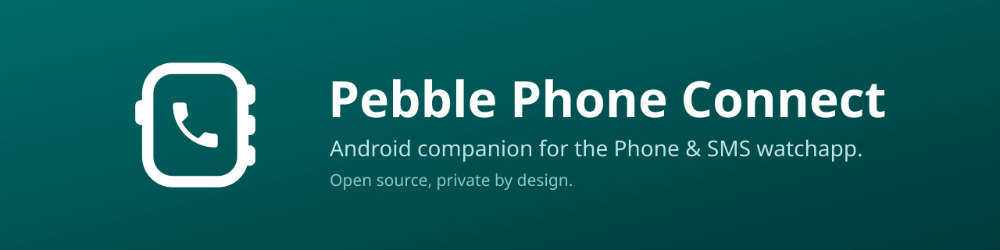
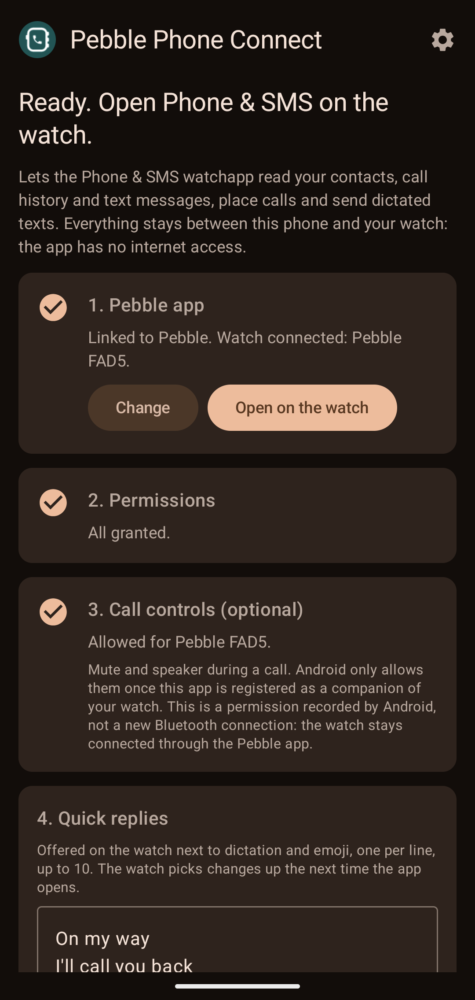
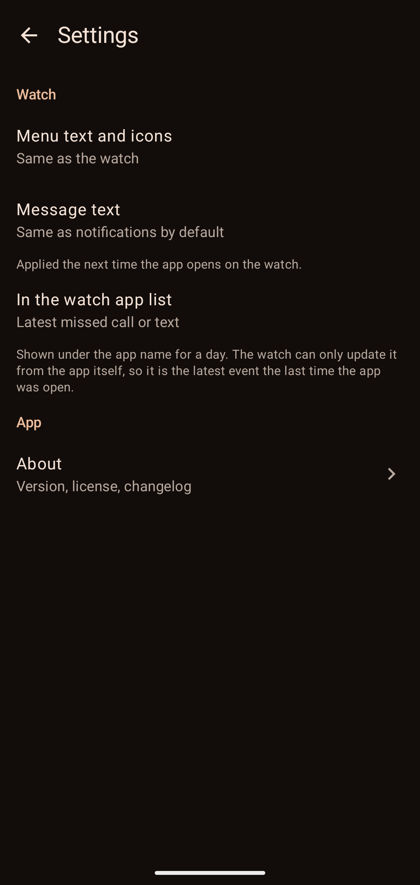
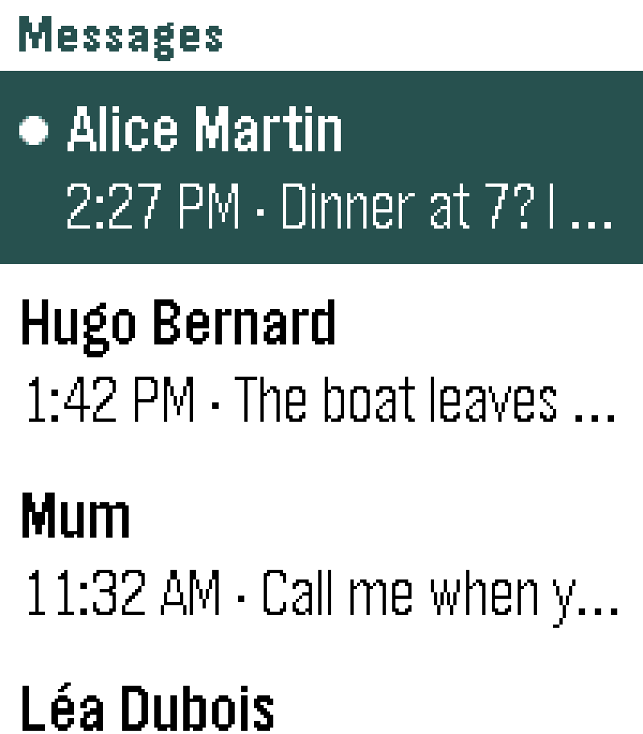
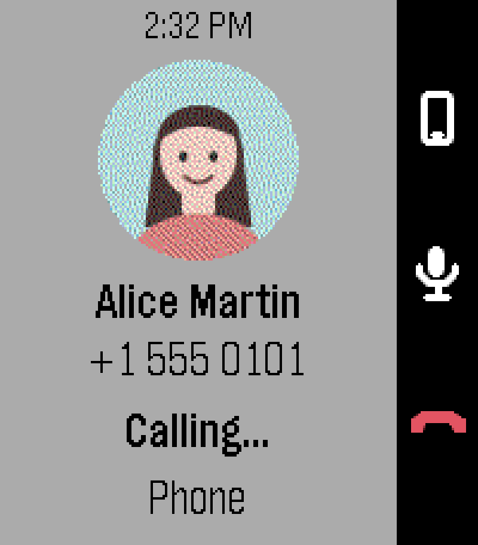

[](https://github.com/loxK/pebble-phone-sms-android/releases/latest)
[](https://github.com/loxK/pebble-phone-sms-android/releases/latest/download/pebble-phone-connect.apk)
[](https://github.com/loxK/pebble-phone-sms-android/actions/workflows/build.yml)
[](LICENSE)

# Pebble Phone Connect

Your calls, contacts and text messages on your Pebble watch. Private by design: the app has no internet access.

Pebble Phone Connect is the Android side of [Phone & SMS](https://github.com/loxK/pebble-phone-sms), the watchapp that puts your phone on your wrist. It reads the phone for the watch, and does what the watch asks: place a call, send a text, open a conversation.

## Get it

<p align="center">
<a href="https://github.com/loxK/pebble-phone-sms-android/releases/latest"></a>

<a href="https://apps.obtainium.imranr.dev/redirect?r=obtainium://add/https://github.com/loxK/pebble-phone-sms-android"></a>
</p>

- 🔄 **Automatic updates:** install from F-Droid, or add this repository to Obtainium if you use the APK from GitHub. Having no internet access, the app never checks for updates itself.
- ⌚ And the **[Phone & SMS](https://apps.repebble.com/17f971c5ad5e4d0babfb4742)** watchapp, from the Pebble App Store.
- 📝 What changed in each version: [`CHANGELOG.md`](CHANGELOG.md).

## Features

- ⭐ **Favorites** displayed as cards with contact photos
- 📇 **Contact directory** browsed by initial, with voice search by name or nickname
- 📞 **Call handling** from the watch: live status, caller photo, duration, mute, audio output (earpiece, speaker, Bluetooth) and hang-up
- 🕘 **Call history** with missed, incoming, outgoing and declined calls
- 💬 **SMS and RCS conversations**, including full message text and pictures
- 🗣️ **Replies** by voice dictation, emoji or predefined quick replies
- 📱 **Handoff to the phone**: any conversation can be opened in the messaging app
- 🔔 **Launcher glance** showing the latest missed call or message
- 📶 **Dual SIM support**: replies are sent from the SIM that received the conversation
- 🔤 **Adjustable text size** for watch menus and messages
- 🌍 **Localized** in English and French

## Privacy

- 🔒 **Private by design.** The app has no internet permission: your contacts, calls and messages go from the phone to the watch, and nowhere else.
- 🎙️ **Dictation** is done by the [Pebble app](https://github.com/coredevices/mobileapp).

## Requirements

- Android 12 or later
- The [Pebble app](https://github.com/coredevices/mobileapp) 1.0.7.7 or later, or another app speaking PebbleKit 2
- A Pebble Time, Time Steel, Time Round, Pebble 2, Pebble 2 Duo, Time 2 or Round 2, with the [Phone & SMS](https://github.com/loxK/pebble-phone-sms) watchapp

## Setup

Open **Pebble Phone Connect** and go through its three steps:

1. **Link** the Pebble app.
2. **Grant** the permissions: contacts, call log, phone, SMS.
3. **Allow call control** (optional, see below).

The same screen holds the **quick replies** offered on the watch next to dictation and emoji.

The settings (⚙️) hold the text sizes of the watch, what its launcher shows and, on a phone with two SIM cards, the SIM texts and calls go out from.

> [!NOTE]
> **Installing the APK from GitHub.** Google Play Protect may flag Pebble Phone Connect as unknown: the app reads text messages and the call log, and is not distributed through the Play Store. Choose **Install anyway**. The APK can be checked as described under [Download & verify](#download--verify).
>
> Android also restricts the SMS and call log permissions of an app installed from a downloaded file. If the permission step cannot grant them, open the app info screen (long press on the icon, then App info), open the ⋮ menu, choose **Allow restricted settings**, and grant the permissions again.

> [!NOTE]
> **About call control.** Android registers Pebble Phone Connect as a companion app of your watch. This lets it control calls in progress (mute, speaker, hang up) and open your messaging app when the watch asks. It is a permission, not a Bluetooth pairing: the watch stays connected through the Pebble app. Without it, the watch can still place a call and hang up.

## Limitations

- **RCS messages are shown, but replies go out as SMS:** Android does not let apps send RCS. Your contact gets the reply in the same conversation, without read receipts.
- **Group conversations are not shown:** a reply sent as SMS would only reach one member.
- Would you like RCS or group replies? [Open a feature request](https://github.com/loxK/pebble-phone-sms-android/issues) so we can gauge the demand.
- A foreign contact saved without its country code may not be recognised: numbers are compared in international format, based on the country of your SIM.
- Call control needs the watch to show up in the phone's Bluetooth settings, and the call is controlled from the watchapp: it has to be open during the call.

> [!TIP]
> Assign Phone & SMS to a quick launch button on the watch (Settings › Quick Launch, for example a long press on Down). During a call, it then opens straight on the call.

## Screenshots

<div align="center">

&nbsp;&nbsp;


<br><br>


&nbsp;&nbsp;


<sub>The setup screen and the settings, then the watchapp on a Pebble Time 2.</sub>
</div>

## Download & verify

The APK from F-Droid and the one from GitHub are the same file, signed with the same key: F-Droid builds the app from source and publishes the APK released here once its own build matches it byte for byte ([reproducible builds](https://f-droid.org/docs/Reproducible_Builds/)). You can move from one to the other without reinstalling.

- Package name: `io.github.loxk.pebblephone`
- SHA-256 hash of the signing certificate:

  ```
  BB:30:9F:1C:32:84:91:6D:B0:92:18:4C:C9:2C:22:A2:A5:EE:E6:E4:EB:C6:2C:8D:6D:C6:CB:DB:63:84:8E:CF
  ```

Every [release](https://github.com/loxK/pebble-phone-sms-android/releases/latest) ships `pebble-phone-connect.apk` with its **SHA-256** (`pebble-phone-connect.apk.sha256`):

```sh
sha256sum -c pebble-phone-connect.apk.sha256          # -> pebble-phone-connect.apk: OK
apksigner verify --print-certs pebble-phone-connect.apk | grep SHA-256
```

## Build from source

With JDK 21 and the Android SDK:

```sh
./gradlew assembleDebug
```

The debug build installs as `io.github.loxk.pebblephone.debug` next to a release build. The `package.json` of the watchapp declares both package names, which is what lets the Pebble app hand them messages.

The messages exchanged with the watchapp are described in [`PROTOCOL.md`](PROTOCOL.md). The About screen of the app shows [`CHANGELOG.md`](CHANGELOG.md), copied into the APK at build time.

## Releases

Pushing a tag `vX.Y.Z` builds a signed APK and publishes a GitHub release with it, its checksum and the matching section of the changelog. The tag has to match `versionName` in `app/build.gradle.kts`, and `versionCode` has to follow it, 1.2.3 becoming 10203: the release workflow checks both.

The signing key never enters the repository. The release workflow reads it from four secrets, `SIGNING_KEYSTORE_BASE64`, `SIGNING_STORE_PASSWORD`, `SIGNING_KEY_ALIAS` and `SIGNING_KEY_PASSWORD`, and checks the APK against the repository variable `SIGNING_CERT_SHA256`. A local release build without them comes out unsigned.

Each release also gets its F-Droid notes, in `fastlane/metadata/android/<locale>/changelogs/<versionCode>.txt`, next to the descriptions and screenshots. The release build leaves out the ART profile and the state of the git checkout, which would make two builds of one commit differ and keep F-Droid from publishing the APK signed here.

## License

Copyright © 2026 Laurent Dinclaux

Released under the **GNU Affero General Public License v3.0 or later** (AGPL-3.0-or-later). See [`LICENSE`](LICENSE).

The handset of the app icon is the "call" icon of [Material Icons](https://github.com/google/material-design-icons), Apache License 2.0.

---

Built with 🥥 and ☕ by Lox — Kanaky-New Caledonia 🇳🇨
